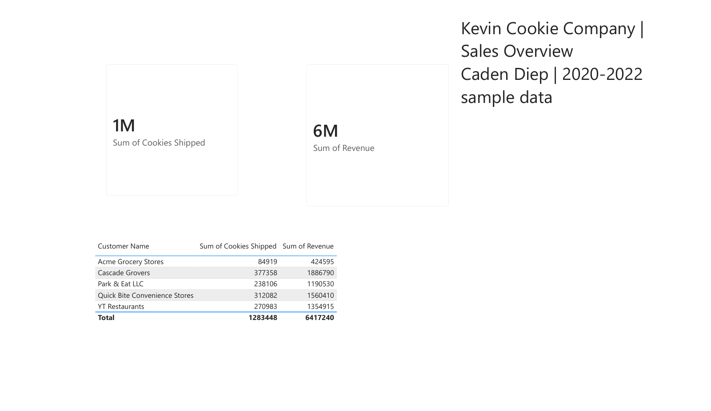

# Kevin Cookie Company Sales Analysis

**Caden Diep — independent portfolio project using an instructional dataset**

## Report files
- [Power BI report](Caden_Diep_Kevin_Cookie_Sales.pbix)
- [PDF export](Caden_Diep_Kevin_Cookie_Sales.pdf)
- [Validation results](validation.json)

Open the `.pbix` in Power BI Desktop to explore the customer summary. The PDF provides a static view. KPI cards use rounded display units; the table shows the exact totals.

To refresh the report on another computer, update the workbook source path in Power Query's Data Source Settings to the included Excel file, then refresh. Power BI Desktop was accessed through UNT's Windows Citrix lab for this Mac-based project.

## Business question
How much product was shipped, how much revenue was generated, and how do those totals vary across customers?

## Data and validation
Source: `Kevin Cookie Company Orders Power BI 10 minutes.xlsx`, supplied with the UNT Power BI lab. This is sample data, not a claim about a real company's operating results.

The workbook contains 2,483 order records spanning January 1, 2020 through December 30, 2022, and five customers. Orders link to Customers through Customer ID in a many-to-one relationship. The imported tables are named Orders1 and Customers2 in Power BI.

Independent checks found no duplicate Order IDs, missing order values, or unmatched Customer IDs. Control totals are 1,283,448 cookies shipped and $6,417,240 revenue. Every record has revenue equal to cookies shipped multiplied by $5. Consequently, revenue rankings reflect shipment volume rather than differences in pricing. The customer summary in Power BI reconciles to these controls.

| Customer | Cookies shipped | Revenue |
|---|---:|---:|
| Acme Grocery Stores | 84,919 | $424,595 |
| Cascade Grovers | 377,358 | $1,886,790 |
| Park & Eat LLC | 238,106 | $1,190,530 |
| Quick Bite Convenience Stores | 312,082 | $1,560,410 |
| YT Restaurants | 270,983 | $1,354,915 |
| Total | 1,283,448 | $6,417,240 |

## Interpretation
Cascade Grovers is the largest customer by revenue and shipments, representing approximately 29.4% of revenue. The small number of customers makes customer concentration a useful question for further analysis. The sample alone does not establish reasons for customer performance or support a forecast.

## Reproduce the validation
Install the packages in `requirements.txt`, then run `python validate.py` from this folder. The script checks key uniqueness, missing order values, customer joins, shipment totals, and revenue totals against the workbook.

## Tools
Power BI Desktop, Excel source data, and Python/pandas for independent validation. Built with AI assistance.
